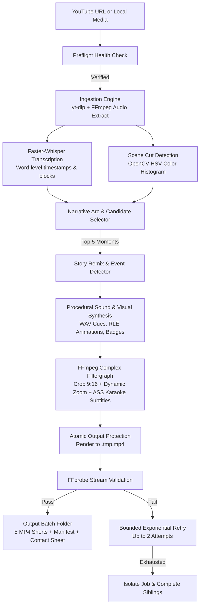

# AI Shorts Generator (Local Production Edition)

An open-source, local-first AI video clipping and automated Shorts production pipeline designed to run natively on macOS and Linux. It transforms long-form YouTube videos and local media into high-retention 9:16 vertical Shorts featuring **Vibrant Pro** animated karaoke typography, intelligent narrative pacing, dead-air removal, dynamic reframing, and optional comedic story remixing.

Built to be orchestrated either via a single-command CLI or conversationally by an AI coding agent (such as **Antigravity**) without requiring external cloud servers, Docker, or paid SaaS API subscriptions.

---

## 📸 Demo Preview

```
+------------------------------------------------------------------------+
|                                                                        |
|                 [ Add Screenshot / Demo Animation Here ]               |
|                                                                        |
|   Recommended: A 9:16 preview or GIF of a rendered Short showing the   |
|   animated subtitles, visual header badge, and dynamic framing.       |
|                                                                        |
+------------------------------------------------------------------------+
```
> _Note: Place your demo screenshot or GIF in `docs/images/demo.png` and update the link above. Ensure any demo media uses original, licensed, or public-domain footage._

---

## ⚡ Key Implemented Features

- **100% Local & Free Execution**: Powered entirely on-device by [Faster-Whisper](https://github.com/SYSTRAN/faster-whisper), [OpenCV](https://opencv.org/), [ONNX Runtime](https://onnxruntime.ai/), and [FFmpeg](https://ffmpeg.org/). No OpenAI, ElevenLabs, or AWS cloud bills.
- **Unified 1-Step CLI (`generate.py`)**: Pass any YouTube URL or prompt to autonomously ingest, transcribe, detect scenes, select the top 5 highlights, render 1080×1920 MP4s, generate contact sheets, and produce structured manifests.
- **Vibrant Pro Subtitle Styling**: Word-by-word active karaoke pop-in animations, neon color palettes (Electric Yellow, Cyan, Coral, Emerald), drop shadows, and strict safe-margin bottom placement (`Alignment=2`, 240px margin) to stay clear of TikTok/Reels UI overlays.
- **Intelligent Narrative Arc Scoring**:
  - Scores candidate clips (15s–30s) by hook strength (question openings, disbelief cues, shock words).
  - Evaluates speech density, narrative coherence, and climactic takeaways.
  - Automatically aligns start/end cuts to natural scene transitions.
- **Pacing & Framing Engine**:
  - Audio gate filtering to detect and trim dead-air / silent gaps.
  - Smart center-weighted 9:16 crop from 16:9 widescreen footage.
  - Camera-aware dynamic zoom bursts (1.0x to 1.15x) timed to high-energy speech boundaries.
- **Story Remix Creative Mode**:
  - Structures clips into 7-beat mini-stories (Opening Hook, Premise Setup, Comedic Pause, Commentary Reaction, Visual Accent, Sound Layer, Punchline Payoff).
  - Comedic freeze-frame detection: pauses video for 0.4s–1.5s during punchlines with a comic vignette, vinyl record scratch, and witty editorial asides.
  - Evaluates transformational originality scores (0.0 to 1.0).
- **Procedural Audio & Visual Engines**:
  - **Procedural Sound Engine**: Generates 48 kHz uncompressed WAV sound effects algorithmically (`record_scratch`, `comic_pop`, `dramatic_hit`, `comedic_sting`, `whoosh`) using NumPy signal synthesis.
  - **Procedural Motion Graphics**: Synthesizes transparent 32-bit QuickTime RLE overlays (`radial_burst.mov`, `speed_lines.mov`, `halftone.mov`) directly in code.
  - **Contextual Animated Emojis**: Composites 14 emotional emoji states with spring physics, rotation, and smooth easing exits.
  - **Narrative Event Badges**: Automatically detects monetary values, surprise reveals, and high-energy statements, rendering glowing badges in the safe upper-third zone (`\an8`, y=240).
- **Production Reliability & Resumability**:
  - Persistent run state tracking (`storage/runs/<run_id>/state.json`).
  - Preflight health verification checks FFmpeg, FFprobe, Node, disk space ($\ge 2.0$ GB), and directory writability before processing.
  - Atomic temporary rendering (`.tmp.mp4`) and FFprobe post-validation prevent corrupted video outputs.
  - Resumes interrupted batch runs instantly without re-rendering already validated clips (`python -m src.cli resume`).
  - Bounded retries (up to 2 attempts) for transient FFmpeg glitches with sibling job isolation.
- **Full-Video 2D Cartoonization (Phase 10)**:
  - Neural cartoonization using AnimeGANv2 ("hayao") and White-box Cartoonizer ("classic_toon") via ONNX Runtime.

---

## 🏗️ Architecture & Workflow



---

## 💻 System Prerequisites & Hardware Support

### Operating Systems
- **macOS**: Apple Silicon (M1/M2/M3/M4/M5) officially supported and hardware-optimized. Intel Macs supported.
- **Linux**: Ubuntu 22.04+ or Debian-based distributions (x86_64 or aarch64).

### Hardware Requirements
- **Memory**: 8 GB RAM minimum; 16 GB+ recommended for Faster-Whisper and batch rendering.
- **Storage**: At least 2.0 GB free disk space (verified by preflight checks) for temporary audio, video, and cache buffers.

### Required Software
1. **Python 3.10+** (Python 3.12 recommended)
2. **FFmpeg 6.0+** (FFmpeg 7.1 recommended) compiled with `libx264` and `libass` support.
   - macOS (Homebrew): `brew install ffmpeg`
   - Linux: `sudo apt-get install ffmpeg libass-dev`
3. **Node.js** (Optional, recommended for `yt-dlp` JavaScript challenge extraction on restricted YouTube URLs).

---

## 🚀 Quick Start & Installation

### 1. Clone the repository
```bash
git clone https://github.com/<your-username>/ai-shorts-generator.git
cd ai-shorts-generator
```

### 2. Create and activate a Python virtual environment
```bash
python3 -m venv .venv
source .venv/bin/activate
```

### 3. Install dependencies
```bash
pip install -r requirements.txt
```

### 4. Configure local environment (Optional)
Copy the example configuration file:
```bash
cp .env.example .env
```
Edit `.env` if you wish to adjust Whisper models (`base.en`, `small.en`, `medium`) or specify custom binary paths.

### 5. Run Preflight Health Verification
```bash
python -m src.cli preflight
```
Ensure all checks pass (FFmpeg, FFprobe, dependencies, writability, disk space).

---

## 🎬 How to Run

### 1. Unified 1-Step Generator (Recommended)
Generate 5 vertical Shorts from any YouTube video in one command:
```bash
# Basic run with URL:
python generate.py "https://www.youtube.com/watch?v=VIDEO_ID"

# With creative prompt / styling instruction:
python generate.py "https://www.youtube.com/watch?v=VIDEO_ID" --prompt "make 5 funny high energy shorts"

# Custom count and duration:
python generate.py --url "https://www.youtube.com/watch?v=VIDEO_ID" --count 5 --max-duration 30
```
Every run automatically outputs to a timestamped folder: `output/run_<timestamp>_<id>/` containing:
- Rendered 1080×1920 MP4 video files (`short_1.mp4`, `short_2.mp4`, etc.)
- `batch_manifest.json` (metadata, durations, scene scores, and validation results)
- `captions.md` (recommended titles, hashtags, and virality notes)
- `contact_sheet.jpg` (visual thumbnail sheet)

---

## 🛠️ Advanced CLI Workflows

### Batch Generation via CLI
```bash
PYTHONPATH=. python -m src.cli batch \
  --url "https://www.youtube.com/watch?v=VIDEO_ID" \
  --count 5 \
  --max-duration 30 \
  --preset full_comedy_remix \
  --editing-intensity dynamic
```

Available Presets:
- `full_comedy_remix`: Full 7-beat mini-story, comedic freeze frames, procedural sound effects, and badge accents.
- `vibrant_pro`: High-energy dynamic zooms, neon animated karaoke subtitles, and emoji reactions.
- `story_remix`: Narrative-driven pacing with story beat progression.
- `clean_pro`: Minimalist crop and clean subtitle layout without visual stickers.

### Resume an Interrupted Run
If a rendering job is terminated prematurely (e.g. power outage or user interruption):
```bash
PYTHONPATH=. python -m src.cli resume --run-id "run_20261022_232118_OHawiI-01Ms"
```
Already completed and validated clips are reused instantly; rendering resumes only for remaining candidates.

### Inspect Runs & System Status
```bash
# List all tracked runs:
PYTHONPATH=. python -m src.cli runs list

# Inspect detailed status of a specific run:
PYTHONPATH=. python -m src.cli runs status --run-id "run_20261022_232118_OHawiI-01Ms"
```

### Cache Management
```bash
# Clean cached transcripts and cuts for a specific video:
PYTHONPATH=. python -m src.cli cache clean --video-id "VIDEO_ID"

# Purge all cached items:
PYTHONPATH=. python -m src.cli cache clean
```

---

## 🎨 Cartoonization Modes & Limitations

The repository includes a 2D neural cartoonization engine (`src/cartoon_engine.py`):
- **Modes**:
  - `hayao`: Ghibli-inspired watercolor anime style via AnimeGANv2.
  - `classic_toon`: Slapstick cartoon style via White-box Cartoonizer.
- **How to Use**:
  ```python
  from src.cartoon_engine import AnimeGANv2CartoonEngine
  engine = AnimeGANv2CartoonEngine(default_style="hayao")
  engine.cartoonize_video("input.mp4", "cartoon_output.mp4")
  ```
- **Known Limitations**:
  - **Performance**: Frame-by-frame neural network inference on CPU is compute-intensive (~20–40s per 30s clip depending on frame size).
  - **Model Downloads**: Model weights (`AnimeGANv2_Hayao.onnx` ~8.6 MB, `whitebox_cartoonizer.onnx` ~5.9 MB) are downloaded automatically from Hugging Face on first call.
  - **License Restrictions**: Model weights carry non-commercial research licenses (see Licensing section below).

---

## 📁 Repository Directory Structure

```
ai-shorts-generator/
├── generate.py                 # Primary entry point script
├── requirements.txt            # Python dependencies
├── .env.example                # Example environment variables
├── .gitignore                  # Git hygiene exclusions
├── README.md                   # Project documentation
├── src/
│   ├── batch.py                # Batch pipeline coordinator
│   ├── cli.py                  # CLI argument parser and commands
│   ├── config.py               # Dynamic configuration and binary paths
│   ├── ingestion.py            # YouTube download & audio extraction
│   ├── transcription.py        # Faster-Whisper local transcription
│   ├── scene.py                # OpenCV scene boundary detection
│   ├── selector.py             # Highlight discovery & narrative scoring
│   ├── framing.py              # 9:16 smart cropping
│   ├── pacing.py               # Silence gate & dynamic zoom bursts
│   ├── subtitles.py            # ASS animated karaoke subtitles
│   ├── events.py               # Upper-third badge event detector
│   ├── storyboard.py           # 7-beat mini-story sequencer
│   ├── comedy_timeline.py      # Freeze-frame timing & sound coordination
│   ├── sound.py                # Procedural audio cue synthesizer
│   ├── anim.py                 # Procedural transparent video overlays
│   ├── reactions.py            # Procedural cartoon reactions
│   ├── emoji_anim.py           # Animated emoji compositing engine
│   ├── cartoon_engine.py       # AnimeGANv2 / Whitebox ONNX engine
│   ├── rendering.py            # FFmpeg filtergraph construction & execution
│   ├── run_manager.py          # Persistent run tracking & atomic state
│   ├── preflight.py            # System prerequisite validation
│   └── logger.py               # Structured logging with token sanitization
├── storage/                    # Storage and asset directory
│   ├── assets/                 # Procedurally generated assets (auto-created)
│   ├── cache/                  # Versioned transcript & scene cache
│   ├── models/                 # Cached ONNX model weights (auto-downloaded)
│   ├── runs/                   # Granular run execution state logs
│   ├── temp/                   # Local working media buffers
│   └── verification/           # Verification frames (excluded from git)
├── output/                     # Generated 9:16 Shorts batches
└── tests/                      # Automated unit & integration test suites
```

---

## 🧪 Testing & Quality Assurance

Run the test suite covering unit logic, visual effects, and fault-injection simulations:

```bash
# Run all tests (36 tests):
PYTHONPATH=. .venv/bin/python -m unittest discover tests -v

# Run individual test modules:
PYTHONPATH=. .venv/bin/python -m unittest tests/test_smoke.py -v
PYTHONPATH=. .venv/bin/python -m unittest tests/test_story_remix.py -v
PYTHONPATH=. .venv/bin/python -m unittest tests/test_phase7_effects.py -v
PYTHONPATH=. .venv/bin/python -m unittest tests/test_reliability.py -v
```

> [!NOTE]
> Unit tests are fully self-contained and run in ~4.5 seconds offline. Tests do not require downloading large neural network models.

---

## 🔒 Privacy & Media Handling

- **100% Offline Processing**: Media is processed entirely on the local machine. Transcripts, audio buffers, and video frames never leave your local environment.
- **Source Footage & Copyright**: Users are responsible for ensuring they possess the appropriate rights, licenses, or fair-use exemptions for any long-form source videos they process. Downloaded source media in `storage/temp/` and rendered output videos in `output/` are excluded from version control via `.gitignore`.

---

## 📜 Licenses & Asset Attribution

### Application Code
The application source code is provided as open source. Choose and apply an appropriate license (e.g., MIT, Apache 2.0) upon repository publication.

### Dependencies
- **[Faster-Whisper](https://github.com/SYSTRAN/faster-whisper)**: MIT License (SYSTRAN).
- **[OpenCV](https://github.com/opencv/opencv-python)**: Apache 2.0 License.
- **[yt-dlp](https://github.com/yt-dlp/yt-dlp)**: The Unlicense (Public Domain).
- **[ONNX Runtime](https://github.com/microsoft/onnxruntime)**: MIT License (Microsoft).
- **[Tenacity](https://github.com/jd/tenacity)**: Apache 2.0 License.
- **[FFmpeg](https://ffmpeg.org/)**: LGPL 2.1+ / GPL 2.0+ (depending on build configuration and enabled external libraries such as `libx264`).

### Cartoonization Models
- **AnimeGANv2 (`AnimeGANv2_Hayao.onnx`)**: The original AnimeGANv2 architecture and weights (TachibanaYoshino / Xin Chen) are licensed strictly for **Non-Commercial Research & Educational Use**. Commercial deployment requires direct authorization from the model creators. Studio Ghibli / Hayao Miyazaki aesthetics are subject to trademark and copyright protections.
- **White-box Cartoonizer (`whitebox_cartoonizer.onnx`)**: Licensed under **Creative Commons Attribution-NonCommercial-ShareAlike 4.0 International (CC BY-NC-SA 4.0)**. Commercial use is prohibited.

### Procedural Sound & Motion Graphics
- Audio cues (`storage/assets/audio/*.wav`) and video overlays (`storage/assets/anim/*.mov`) are procedurally synthesized using NumPy, OpenCV, and mathematical wave functions. They are free from third-party royalty claims and dedicated to the public domain (CC0 1.0).

### Fonts & Emoji Rendering
- Subtitles utilize standard system typography (e.g., Arial Black / Impact).
- Animated emojis are rendered on macOS via Apple Color Emoji font for on-device display only. Apple Color Emoji is proprietary to Apple Inc.

---

## 🗺️ Project Roadmap

| Feature / Capability | Status | Implementation Details |
| :--- | :---: | :--- |
| **Unified 1-Step Generator** | ✅ Implemented | `generate.py` accepts YouTube URL or prompt and outputs 5 vertical Shorts |
| **Local Speech-to-Text** | ✅ Implemented | Faster-Whisper via CTranslate2 CPU on Apple Silicon & Linux |
| **Scene Cut Boundary Detection** | ✅ Implemented | OpenCV HSV histogram distance thresholding |
| **Intelligent Moment Selection** | ✅ Implemented | Hook analysis, question opening detector, and speech pacing |
| **Vibrant Pro Subtitles** | ✅ Implemented | ASS active karaoke word pop-in animations with neon palettes |
| **Dead-Air Trimming** | ✅ Implemented | Dynamic audio gate filtering |
| **Comedic Freeze-Frames** | ✅ Implemented | 7-beat story sequencing with spotlight vignette and record scratch |
| **Procedural Audio Synthesis** | ✅ Implemented | 5 procedural WAV sound effects generated algorithmically |
| **Contextual Animated Emojis** | ✅ Implemented | 14 emotional emoji overlays with spring physics |
| **Production Run Manager** | ✅ Implemented | State tracking, atomic `.tmp` writes, preflight checks, and CLI resume |
| **2D Video Cartoonization** | ✅ Implemented | ONNX Runtime AnimeGANv2 / Whitebox (Non-commercial) |
| **Multi-Speaker Diarization** | ⏳ Planned | Differentiating multiple speakers via pyannote-audio |
| **Face-Tracking Pan & Scan** | ⏳ Planned | Real-time multi-face bounding-box tracking for wide shots |
| **Web UI Dashboard** | ⏳ Planned | Browser-based interactive timeline editor and review UI |
| **Platform Direct Publishing** | ⏳ Planned | Optional YouTube Data API / TikTok API direct scheduled upload |
